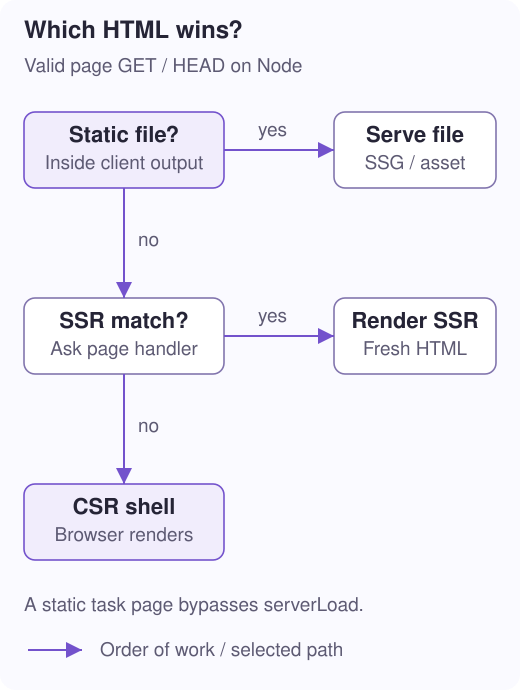

# 7. Build and serve a mixed app

**Question:** how do Wrap, standalone SSR, SSG files, and the hosting server fit together?

**You will learn:** the two integration levels, a mixed-app build, file-first serving, and the limits of each deployment target.

## Wrap composes the pieces; it does not replace the engine

For an application using `initializeApp`, use the wrapper's Vite composition and hydration plugin. Wrap is a **facade**: a coordinated public entry point over collaborating libraries, not a second rendering engine. The server captures the existing application declarations; you do not duplicate the component registry or SSR route list.

```ts
// vite.config.ts — wrapper-based build configuration.
import {defineConfig} from 'vite';
import {dotaVitePlugins} from '@ayu-sh-kr/dota-wrap/vite';

export default defineConfig({
  plugins: dotaVitePlugins({
    deployment: 'node',
    ssg: {
      autoDetectRoutes: true,
      routes: ['/tasks/42'],
    },
  }),
});
```

This config assumes the project's TypeScript/decorator setup and page discovery are already configured. Keep the `dotaHydration` startup from [lesson 6](/docs/ssr-hydration). Declare SSR routes with explicit `mode: 'ssr'`.

The composition includes the SSR plugin by default; applications with no detected SSR routes do not get a request server. `ssr: false` disables it. SSG remains opt-in through its options and the `--ssg` build flag. `deployment` selects generated hosting files; it does not upload or deploy them. Nested `ssg.deployment` or `ssr.deployment` can override the shared target.

```sh
# From the app directory, using a build:ssg script equivalent to this:
pnpm exec vite build -- --ssg

# For the generated Node target, from the app directory:
node dist-server/server.mjs
```

The SSR build preserves the original client shell before SSG can overwrite `dist/index.html`. Otherwise a later CSR fallback might accidentally receive the home page's prerendered state.

## Standalone SSR: wire the lower-level contract

You do not need Wrap or `initializeApp` to use the request-time engine. Register constructors and page paths directly, then adapt its standard `Request`/`Response` contract to your host.

```ts
// server.ts — ESM server entry. Load the server environment before components.
import {
  createRequestHandler, createStringAdapter,
} from '@ayu-sh-kr/dota-ssr/server';

const {COMPONENTS} = await import('./components.js');

export const handler = createRequestHandler({
  adapter: createStringAdapter({components: COMPONENTS}),
  routes: [{path: '/tasks/:id', page: 'task-page'}],
  template: `<!doctype html><html>
    <head><!--dota-head--></head>
    <body><!--dota-body-->
      <script type="module" src="/assets/client.js"></script>
    </body></html>`,
});

const response = await handler(new Request('https://example.com/tasks/42'));
console.log(await response?.text());
```

`COMPONENTS` must contain the decorated `task-page` class and registered descendants. The script URL is an illustrative built browser asset; your build/host must provide it. `response?.text()` means “read the response if one exists”; unknown paths return `undefined`. A browser entry must register components and install the hydration strategy if it should reuse this output.

The `/server` entry installs minimal server globals before Core's element classes are evaluated. The dynamic component import makes that order explicit. A prebuilt browser module already evaluated against a different DOM realm is not an interchangeable server component module.

For an existing Node middleware stack, `toNodeListener(handler)` bridges Node requests/responses and lets declined requests reach `next`. The separate `dota-ssr/node` entry provides a ready-made static-plus-SSR host. Keeping Node hosting separate avoids forcing `node:http` into every server bundle.

> **Working example:** the [light-DOM playground server](../../../../../../packages/libs/dota-ssr/playground/light-dom/server.mjs) combines Vite assets, a small API, `createStringAdapter`, and `toNodeListener`. Its [browser entry](../../../../../../packages/libs/dota-ssr/playground/light-dom/src/client.ts) installs the mount strategy before `bootstrap`, without a router.

## Follow the Node host's decision



For a normal page GET, `createNodeServer` first looks for an existing static file safely inside the client directory. It can resolve directory `index.html` and clean-URL `.html` candidates, and redirects (308) to the canonical form like a static host: `/about` to `/about/` for `about/index.html`, `/about/` to `/about` for `about.html`. If none exists, it asks the SSR handler. If the handler declines, the host serves the clean CSR fallback shell.

| Request | Available output | Result |
| --- | --- | --- |
| `/tasks/42/` | `dist/tasks/42/index.html` exists | Serve the SSG snapshot; do not call `serverLoad`. `/tasks/42` redirects here first. |
| `/tasks/99` | No static file; `/tasks/:id` is SSR | Render a fresh page for this request. |
| `/editor` | No static file or SSR match | Send the CSR shell; browser routing creates the page. |

This is the **static-first** pattern. Prerendering an SSR URL changes which path wins for that URL on this host. Do not expect live request data to override an existing static snapshot.

The chart covers successful page selection. Malformed paths are rejected, unsupported methods return 405, and rendering failures are 500 errors rather than silently returning a CSR page. HEAD follows selection without sending a body. SSR does not provide API endpoints, authentication, or a universal cache policy for your application.

## Deployment is platform-specific

| Target | Generated integration / important boundary |
| --- | --- |
| Node | Server bundle, startup, and preserved fallback shell; filesystem/static-first serving as above. |
| Vercel | Function integration and SSR rewrites. Root static-index precedence is a platform caveat; review generated configuration. |
| Netlify | Function plus routing rules for SSR paths. |
| Cloudflare Pages | Advanced worker with asset fallback and Node-compatibility configuration. |
| GitHub Pages | Static files only; no request-time SSR. The build warns and relies on client rendering where applicable. |

Do not assume every platform uses Node's exact file lookup/rewriting policy. Inspect the output for your target. Secondary Vite builds filter out recursive SSR/SSG and artifact writers so building the server does not trigger another full application build loop.

**In the code:** [Wrap Vite composition](../../../../../../packages/libs/dota-wrap/src/vite/index.ts), [SSR Vite plugin](../../../../../../packages/libs/dota-ssr/src/vite/ssr/plugin.ts), [node-server.ts](../../../../../../packages/libs/dota-ssr/src/ssr/node-server.ts), and [deployment/server.ts](../../../../../../packages/libs/dota-ssr/src/vite/deployment/server.ts).

**Next: [8. Packages and server limits →](/docs/ssr-package-map)** · [Collection](/docs/ssg-ssr-csr)
