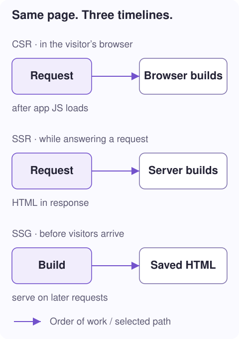

# 1. From URL to HTML

**Question:** when someone opens `/tasks/42`, where does the page come from?

**You will learn:** the request/response cycle, the browser's role, and the difference between CSR, SSR, SSG, and hydration. No server-rendering experience needed.

## Start with a document, not a component

A browser asks a server for a URL. The server replies with a document, usually HTML. The browser parses that text into a **DOM**: an in-memory tree of elements. CSS styles the tree; JavaScript can change it and respond to clicks.

```text
GET /tasks/42 HTTP/1.1
Host: example.com
```

```html
<!-- A simplified HTML response, not a complete Dota document. -->
<!doctype html>
<html>
  <head><title>Task 42</title></head>
  <body><h1>Task 42</h1></body>
</html>
```

`GET` means “retrieve this resource.” `/tasks/42` is the path. The server can choose the response from a file or create it by running code. That choice is the foundation of this collection.

> **Server** means the process answering the request, not necessarily a physical machine. A Node process or a platform function can fill that role. A **build** is the earlier process that turns source code into deployable files.

## Three ways to produce the first page



With **client-side rendering (CSR)**, the response contains an application shell and JavaScript references. The browser downloads the app, constructs components, and produces the page content. The shell itself can contain authored HTML; “CSR” does not mean the response has literally zero markup.

With **server-side rendering (SSR)**, a request triggers component execution on the server. The response already contains that page's content. It can depend on this request's URL or freshly fetched data. CSS, images, and JavaScript may still need to load.

With **static site generation (SSG)**, a build visits selected URLs beforehand and saves their HTML. The host later serves those files. No component needs to run per request for a static-file hit. Data baked into those files remains a build-time snapshot until rebuilt, unless browser code updates it.

| For `/tasks/42` | CSR | SSR | SSG |
| --- | --- | --- | --- |
| When is page HTML produced? | In the visitor's browser | While answering the request | Before deployment, during the build |
| Must this URL be known at build time? | No | No; `/tasks/:id` can match it | Yes; select a concrete URL |
| Does a static-only host suffice? | Yes, with URL fallback | No, not for request-time execution | Yes |
| Can browser JavaScript run afterward? | Yes | Yes | Yes |

## Tell Dota your initial-delivery policy

```ts
// Route-decorator examples; each belongs on its own page class.
@Route({path: '/tasks/:id', mode: 'ssr'})
@Route({path: '/about', mode: 'ssg'})
@Route({path: '/editor', mode: 'csr'})
```

The `:id` segment is a **parameter**: `/tasks/42` captures `id = '42'`. It is a pattern, not a folder named `:id`.

Dota's explicit `mode` wins over the older `ssr` boolean. Without an explicit mode, legacy `ssr: true` means **SSG**, not request-time SSR. Otherwise the default is CSR. Prefer explicit modes so intent is unambiguous.

> **Important boundary:** route mode chooses how the initial document is delivered. Clicking a link handled by the already-running browser router does not automatically request a new server-rendered document. The browser must initialize data for that navigation too.

## HTML is not an interactive app yet

An SSR response might already show a button:

```html
<button>Save task</button>
```

The text is visible before your application's event handler is attached. **Hydration** is the browser-side integration that reuses compatible HTML and connects it to the app's rendering and event machinery. **Mounting** instead creates a fresh rendered tree in a host element.

Dota distinguishes these operations; some initial root/page content is preserved with a deferred renderer rather than immediately adopting every dynamic part. [Lesson 6](/docs/ssr-hydration) explains that distinction with before/after examples.

## Check your understanding

If `/tasks/42/index.html` was generated yesterday and served unchanged today, that request used **SSG output**, even though the build executed on a server. If a request today runs `serverLoad` and creates fresh HTML, that is **SSR**. The deciding factor is *when the page HTML is produced*, not the machine's location.

**In the code:** [render-mode.ts](../../../../../../packages/libs/dota-core/src/core/render/render-mode.ts) owns the mode types and `resolveRouteRenderMode`. [route-renderer.ts](../../../../../../packages/libs/dota-router/src/coordinator/route-renderer.ts) owns ordinary browser route presentation.

**Next: [2. Write a server-ready component →](/docs/ssr-component)** · [Collection](/docs/ssg-ssr-csr)
