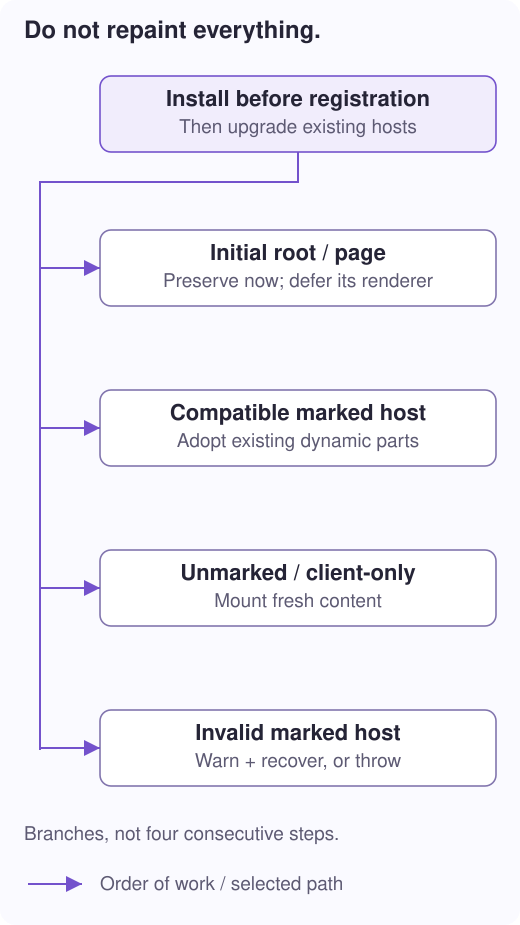

# 6. Make HTML interactive

**Question:** what happens between seeing server-produced HTML and clicking a working button?

**You will learn:** browser registration order, mounting versus adoption, initial-route preservation, client-only hosts, and mismatch recovery.

## The server does not send component objects

The response contains text: HTML elements, attributes, comments, and script references. The browser parses elements before it knows your component classes. JavaScript then registers those classes; `customElements.define` can **upgrade** matching elements that are already present.

Upgrading connects a real component instance to an existing custom element. Without hydration integration, ordinary mounting can replace its children and discard useful SSR/SSG output.

```ts
// main.ts: install the plugin through app startup, before element registration.
import {initializeApp} from '@ayu-sh-kr/dota-wrap';
import {dotaHydration} from '@ayu-sh-kr/dota-wrap/ssr';

export const applicationReady = initializeApp({
  modules: components,
  routes: routeConfig,
  root: AppComponent,
  plugins: [dotaHydration({mismatch: 'warn'})],
});
```

`components`, `routeConfig`, and `AppComponent` refer to your application declarations. Wrap runs plugin setup before bootstrap defines the custom elements. Installing the strategy after registration is too late to protect their initial mount.



## Three words that are not interchangeable

| Operation | What happens to the existing children? |
| --- | --- |
| **Mount** | Create the output as a fresh rendered tree. Existing server children are not adopted. |
| **Hydrate / adopt parts** | Use compatible markers to attach a render session to existing dynamic regions. Reuse eligible nodes. |
| **Defer rendering** | Leave the current tree alone now; create a normal mounted session on the first later update. |

A **render session** remembers how future outputs relate to nodes/parts. It is how `updateHTML()` can update an existing component rather than treating every render as unrelated text.

For ordinary eligible hosts, the hydration mount strategy checks the structured template's identity, marker version, and scope before calling Rendering's `hydrate`. Missing markers take the ordinary mount path. Marked but incompatible output follows the mismatch policy.

## Why the root and initial page need special handling

At startup the router also wants to display its first page. If it replaced a server-produced page host, even correctly marked descendants could disappear.

The plugin captures the direct marked page inside the root before bootstrap. While that initial route is pending, root/page rendering can use `deferRender` to preserve the tree. The route wrapper then checks the path, page selector, placement, and route-marker compatibility. A matching initial transition keeps the page instead of painting it again.

> **“Handoff” simply means transferring responsibility.** The server produced the initial markup; browser components and the router now take responsibility for it. It is not a separate API or an empty document.

This implementation does **not** mean every root/page dynamic part is immediately adopted. Their deferred session mounts normally on the first later update. Ordinary eligible descendant hosts can hydrate their parts. A later navigation uses normal routing; a custom route `render` callback remains authoritative.

## What an “empty client-only host” actually is

For a browser-only widget, declare a component-level opt-out:

```ts
@Component({selector: 'map-widget', shadow: false, mode: 'csr'})
export class MapWidget extends BaseElement {
  render() {
    return html`<p>Map tools</p>`;
  }
}
```

The enclosing page can still be SSR or SSG. On the server, the widget leaves only a placeholder element:

```html
<!-- Delivered HTML: the host exists, but contains no rendered widget. -->
<map-widget data-dota-csr=""></map-widget>
```

After browser registration and ordinary mounting:

```html
<!-- Simplified browser DOM: the widget now has content. -->
<map-widget><p>Map tools</p></map-widget>
```

That is all “empty browser handoff” was trying to describe: **keep a place for the component, let the browser create its contents**. It is not hydration of nonexistent child nodes. Required server content should not live inside a client-only widget. Keep browser-only work out of its constructor too: string SSR constructs the class before deciding to skip its render.

## Events and updates return to normal Dota behavior

```ts
// Methods/field inside a browser component.
count = 0;

@BindEvent({event: 'click', id: '#increment'})
increment() {
  this.count += 1;
  this.updateHTML();
}

render() {
  return html`<button id="increment">Count: ${this.count}</button>`;
}
```

Core's connection lifecycle handles properties, params, binding, events, and after-init work. It retains the chosen render session for updates. No browser click handler runs on the request-time server. `updateHTML()` does not call `serverLoad` again.

For initial consistency, the browser must recover the same state from supported attributes or another explicit application mechanism. Random values, different time-dependent output, or server-only fields can create mismatches even when the template's static shape is unchanged.

## Recognize fallback, not just success

`mismatch: 'warn'` reports incompatibility and permits recovery by remounting the affected host; route mismatch permits normal route presentation. `mismatch: 'throw'` surfaces it as an error, useful for catching server/client deployment skew. Neither policy creates missing data or makes incompatible templates equivalent.

Check the console, retained nodes, and rendered result rather than treating one hydration flag as proof that every nested part was adopted. Deploy HTML and its matching JavaScript together.

**In the code:** [dotaHydration and its mount/route strategies](../../../../../../packages/libs/dota-ssr/src/index.ts), [render-strategy.ts](../../../../../../packages/libs/dota-core/src/core/elements/render-strategy.ts), [renderer.ts](../../../../../../packages/libs/dota-rendering/src/renderer.ts), and the [standalone browser setup](../../../../../../packages/libs/dota-ssr/playground/light-dom/src/client.ts).

**Next: [7. Build and serve a mixed app →](/docs/ssr-hosting)** · [Collection](/docs/ssg-ssr-csr)
