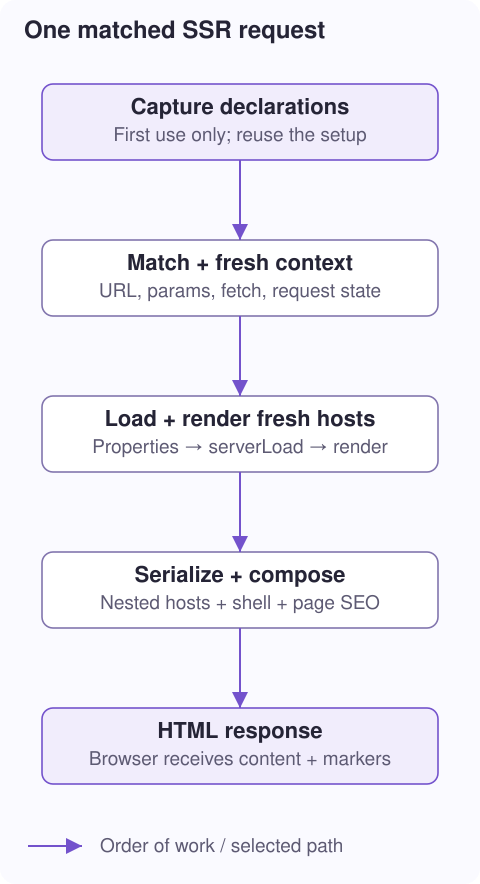

# 3. Inside one SSR request

**Question:** which functions turn `GET /tasks/42` into a complete HTML response?

**You will learn:** the two setup/render phases, application capture, request context, component recursion, and document composition.

## Separate declarations from a visitor's page

The server needs to know *which classes and routes exist* before it can render a request. That setup can be reused. A visitor's component instances and request state must not be reused.



**Capture once, render many times** is the pattern. It avoids rediscovering declarations for every visitor while keeping each render's mutable component state separate.

## First use: capture the application

`createApplicationHandler(loadEntry, options)` lazily prepares the application. “Lazy” means the work begins on first use, not just because the module was imported.

1. `captureApplication` installs a temporary capture hook and loads the app entry inside a server browser scope.
2. `initializeApp` notices that hook. It reports the components, routes, root, and fallbacks instead of starting the browser router or registering a live application.
3. `resolveServerRoutes` flattens nested paths and selects routes whose resolved mode is `ssr`. Routes with a custom `render` callback are skipped.
4. The handler creates a string adapter and prepares the document shell. These declarations and the handler are cached for later requests.

> **Capture hook:** a temporary callback that receives the application's declarations. It is not a network request, a rendered page, or a browser lifecycle event. Captures are queued because the hook occupies one global slot. Module-level side effects still execute while importing the entry; browser startup chained after the intercepted `initializeApp` does not.

This is why the same `initializeApp` declarations can support Wrap-driven SSR without a second manually maintained route list. A failed capture clears the cached promise so a later attempt can retry.

## Every request: match and create context

`createRequestHandler` accepts a standard `Request`. It declines methods other than GET/HEAD and paths it does not own by returning `undefined`. That means “let the host try another handler,” not “send an empty successful HTML page.”

```ts
// Values created for GET https://example.com/tasks/42?tab=details:
context.url.pathname;  // '/tasks/42'
context.params.id;     // '42', captured by /tasks/:id
context.state;         // new Map() for this request only
await context.fetch('/api/tasks/42'); // resolves against https://example.com
```

The matcher checks routes in order; first match wins. It supports literal and `:name` path segments and ignores trailing slashes. It is not the complete browser router or an API/authentication layer. `context.state` is a request-local `Map` shared with descendants; `Map` is a key/value store, not a client-state transfer mechanism.

`context.fetch` resolves URLs; it does not automatically forward the visitor's cookies or authorization headers. An application that needs authenticated server fetches must explicitly supply that behavior without putting visitor-specific credentials into shared global state.

## Every host: construct, load, render

The **adapter pattern** separates request orchestration from the HTML engine. The handler calls `adapter.render(selector, context)` and receives `{html, head?}`; `head?` means metadata is optional. The default string adapter supplies that contract. Another engine could implement it without rewriting route matching and response composition.

For the matching page, `createStringAdapter` performs this sequence:

```text
new TaskPage()
  → apply input attributes
  → seed @Property fields
  → await serverLoad(context)
  → reflect supported properties into host attributes
  → call render() once
  → serialize the template
  → render registered descendant component hosts
```

The adapter finds custom-element hosts in the output and repeats the process. Siblings may load concurrently; the assembled result stays in document order. Scope IDs are normalized afterward so concurrent completion does not change their final numbering. The default nesting limit of 32 stops endlessly self-including components.

```html
<!-- Simplified nested result; markers omitted. -->
<task-page task-id="42">
  <h1>Task 42</h1>
  <task-summary label="Open">
    <p>Status: Open</p>
  </task-summary>
</task-page>
```

Only registered component tags are instantiated. Ordinary HTML remains HTML. The tokenizer avoids treating text inside scripts, comments, or inert templates as live component hosts. A client-only component instead leaves a marked, empty host; [lesson 6](/docs/ssr-hydration) shows exactly what that means.

> **Not a browser simulation:** request-time string SSR does not call `connectedCallback`, bind browser events, run `@AfterInit`, or calculate layout. Use `serverLoad` for required server data and keep `render()` a description of prepared state.

## Finish the document and response

The **shell** is the surrounding HTML document: doctype, head, root element, styles, and script references. **Outlets** are placeholder comments that identify where generated content belongs.

```html
<!doctype html>
<html>
  <head><!--dota-head--></head>
  <body>
    <app-root><!--dota-body--></app-root>
    <script type="module" src="/assets/app.js"></script>
  </body>
</html>
```

`prepareDocumentShell` can add the outlets to an existing shell. `renderDocument` replaces the head outlet with SEO tags and the body outlet with the rendered page. It preserves the shell's assets. This does **not** run the root component's browser lifecycle to render an application chrome.

The adapter reads a page's `seo` after loading/rendering. If the result has no head metadata, the handler uses route SEO as a whole-object fallback, not a per-field merge. Shared Core code describes managed head tags, including JSON-LD. Appending to the server shim's `document.head` is not how response SEO is collected.

Finally the handler returns `Response` with `text/html; charset=utf-8`. Output is buffered: the complete string is assembled before returning, not streamed in fragments. Render errors propagate to the host. The Node host sends no body for HEAD, although rendering still occurs.

**Follow the functions:** [application.ts](../../../../../../packages/libs/dota-ssr/src/ssr/application.ts) → [request-handler.ts](../../../../../../packages/libs/dota-ssr/src/ssr/request-handler.ts) → [string-adapter.ts](../../../../../../packages/libs/dota-ssr/src/ssr/string-adapter.ts) → [document.ts](../../../../../../packages/libs/dota-ssr/src/ssr/document.ts). Their full function tables remain in the [file reference](/docs/ssr-file-reference).

**Next: [4. Templates become HTML →](/docs/ssr-templates)** · [Collection](/docs/ssg-ssr-csr)
