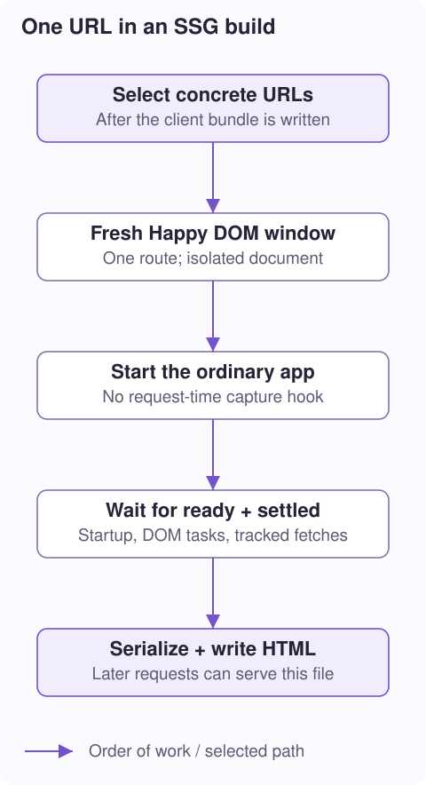

# 5. SSG: render at build time

**Question:** if SSR already creates HTML, why is SSG a different path here?

**You will learn:** concrete route selection, Happy DOM startup, readiness and settling, asset/API fetches, isolation, and generated files.

## Same goal, different execution engine

Request-time SSR constructs a component and calls its server hook. Dota's current SSG runs the **ordinary application** in Happy DOM, a DOM implementation that runs in Node. It waits for that application to finish meaningful work, then saves the document.



This is not a request-time `serverLoad` loop, a screenshot, or a full browser with layout and painting. Browser-style lifecycle code runs, but graphics, measurements, and browser-only APIs still require care.

## Select real URLs, not an infinite pattern

```ts
// vite.config.ts: SSG options inside dotaVitePlugins(...).
ssg: {
  autoDetectRoutes: true,
  routes: ['/tasks/42', '/tasks/99'],
  concurrency: 1,
  deployment: false,
}
```

Auto-detection reads preloader metadata and selects routes resolving to SSG. A pattern like `/tasks/:id` does not enumerate every possible ID. A discovered dynamic SSG route is rejected rather than producing a literal `:id` file—even if concrete paths were also supplied. Keep a parameterized route SSR/CSR and list the concrete URLs explicitly instead.

Explicit paths can prerender selected URLs even when their page normally has `mode: 'ssr'` or `mode: 'csr'`. That enables a mixed policy: prebuild popular task IDs, render other IDs per request. Explicit mappings override discovered output mappings for the same path.

```text
URL /             → dist/index.html
URL /about        → dist/about/index.html
URL /tasks/42     → dist/tasks/42/index.html
```

The normalizer validates paths and outputs before writing: duplicate output collisions, escaping the output directory, and query/hash-based paths are not valid output mappings.

## Export a startup promise

```ts
// main.ts: actual app startup, not SSR capture.
export const applicationReady = initializeApp({
  modules: components,
  routes: routeConfig,
  root: AppComponent,
  plugins: [dotaHydration({mismatch: 'warn'})],
}).then(async () => {
  await initializeApplicationData();
});
```

Here `components`, `routeConfig`, `AppComponent`, and `initializeApplicationData` are application-owned values. The important contract is the exported promise. SSG awaits `applicationReady` by default; `readyExport` can select another export. Export a real promise, not a boolean saying “started.” A promise represents work whose completion can be awaited.

The pre-render runner enables server-render/hydration emission, loads the entry, and runs normal `initializeApp`. The request-time application-capture hook is **not** active. Custom elements connect, the router starts, and after-init work can run.

> **For the task example:** SSG reaches `initializeFromBrowserUrl`, not `serverLoad`. If the initial static HTML needs API data, the normal startup/data-loading path must request it. Putting it only in `serverLoad` will not populate SSG output.

## “Ready” and “settled” are different

**Ready** means the app's exported promise resolved. **Settled** means the runner has also waited through supported pending DOM work and tracked fetches, checking again for work they trigger. A fetch might finish and then schedule another DOM update; waiting for just one promise would miss that.

The loop has limits: a default 30-second settling budget and at most 25 passes. If work keeps polling, SSG warns and writes the page as rendered so far. Successful file creation is not proof that every asynchronous feature completed.

An optional `settle(window, route)` callback is an application-specific barrier; afterward the runner checks pending work again. That callback cannot be transferred to parallel workers, so use it with sequential generation.

## Fetches need a build-time destination

```ts
// For relative API fetches that are not built public files:
ssg: {
  routes: ['/tasks/42'],
  fetchBaseUrl: 'https://api.example.com',
}
```

Same-origin GET/HEAD fetches first try built assets safely inside the output directory. Missing local assets can fall back to `fetchBaseUrl`. Cross-origin URLs use the network. Without a configured API base, a relative `/api/tasks/42` is not magically handled by your production API.

Generated page outputs are excluded from the asset cache so one route does not accidentally consume another route's newly generated document. Build caches reuse eligible asset bytes and simple GET responses, not live DOM nodes or component instances. They are not a deployment CDN cache or an SSR page cache.

## Each route gets its own window

`prerenderRoute` creates a fresh Happy DOM window at a synthetic URL for each path. It installs that window's globals/fetch bridge, writes the shell, reevaluates application modules for the route, waits, marks the route, and serializes the whole document.

Finally it closes pending work, tears down the window, and restores the previous global descriptors. With `concurrency > 1`, a bounded worker pool gives workers separate runners and caches; each route still gets a fresh window. Workers await successful output writes before receiving more work. More workers can cost more startup time and memory, so they are not automatically faster.

Run the existing site pilot from the workspace root:

```sh
# Uses the app's configured SSG paths and Node hosting target.
DOTA_DEPLOYMENT=node pnpm --filter dota-web run build:ssg
```

The `--ssg` build flag activates the static-generation plugin. An ordinary build does not implicitly generate every selected static page.

**Follow the functions:** [generateStaticPages](../../../../../../packages/libs/dota-ssr/src/ssg/generate.ts), [prerenderRoute](../../../../../../packages/libs/dota-ssr/src/ssg/prerender-runtime.ts), [route-output.ts](../../../../../../packages/libs/dota-ssr/src/ssg/route-output.ts), [prerender-fetch.ts](../../../../../../packages/libs/dota-ssr/src/ssg/prerender-fetch.ts), and [render-workers.ts](../../../../../../packages/libs/dota-ssr/src/ssg/render-workers.ts).

**Next: [6. Make HTML interactive →](/docs/ssr-hydration)** · [Collection](/docs/ssg-ssr-csr)
