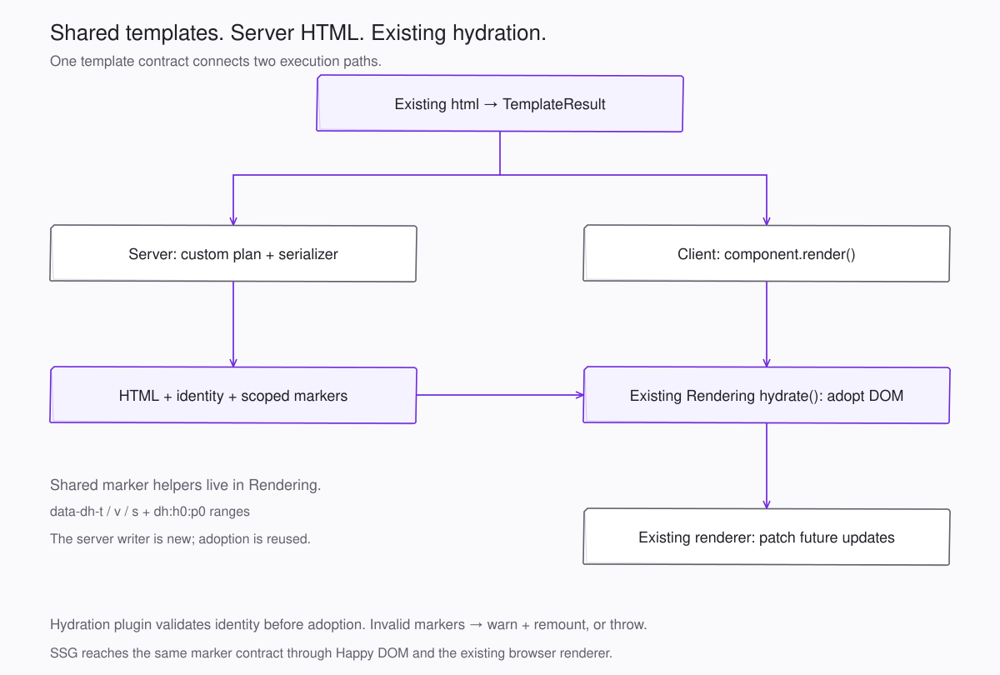
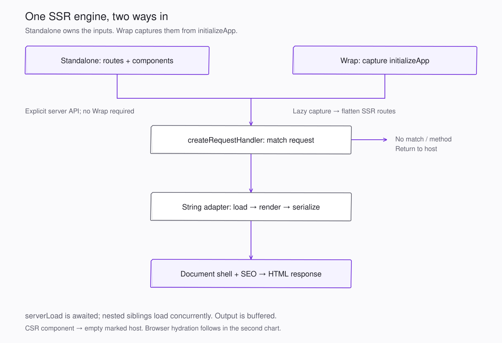

# Dota SSR: package boundaries and execution

For a file-by-file explanation of this branch's implementation, tests, and
supporting files, read the [branch changes guide](branch-changes-guide.md).

Reviewed against the current working tree on 2026-10-18, including the uncommitted
SSR deployment, DOM shim, serializer, and shared-marker changes. Reassessed against
the npm registry and published declarations on the same date. SSR orchestration stays
in `@ayu-sh-kr/dota-ssr`. The repackaging described below is now implemented in the
working tree: the HTML pipeline moved to `@ayu-sh-kr/dota-rendering/server`, and the
server DOM became the new `@ayu-sh-kr/dota-server-dom` package. See
[Validation of the original claims](#validation-of-the-original-claims).

`dota-ssr` already works without `dota-wrap`. It is standalone within the Dota
ecosystem, rather than framework-independent: its component engine depends on
Dota Core and Dota Rendering. Wrap supplies application configuration, runtime
plugin wiring, and Vite composition around the same implementation.

## Published packages versus working-tree additions

The registry versions differ from the checked-out manifests. A source export or
an existing changeset is not evidence that the feature has shipped.

| Existing package | npm `latest` checked | Relevant published surface | Current additions or proposed extensions |
| --- | --- | --- | --- |
| `dota-ssr` | 0.3.0 | Root hydration API, `/vite`, `/worker` | Working tree adds request rendering, application capture, automatic SSR deployment, `/server`, and `/node`. Keep these in this package. |
| `dota-rendering` | 0.1.6 | `html`, directives, `hydrate`, patches, template identity, marker version 2, and identity attribute constants | Working tree adds shared marker builders. A proposed `/server` subpath can own template-to-HTML serialization. |
| `dota-core` | 1.11.0 | Component/property/lifecycle package | Keep property seeding, render-mode policy, and shared SEO contracts here; current SEO/JSON-LD additions follow that ownership. |
| `dota-router` | 0.3.0 | Routing package | Retain client routing and route presentation contracts here. The minimal SSR request matcher remains an SSR concern. |
| `dota-runtime` | 0.0.8 | Type-only runtime extension contracts; its export map has no JavaScript entry | Reuse plugin/socket contracts. Application-capture types could join this existing contract package, but moving the actual capture-hook functions requires a new executable subpath/build. |
| `dota-wrap` | 0.2.4 | Facade with `/rendering`, `/ssr`, `/ssg`, `/vite`, and other ecosystem entries | Keep application composition and forwarding here. Extend the existing facade when new public capabilities need exposure. |
| `dota-server-dom` | not published | New package | Server DOM stand-ins moved out of `dota-ssr/src/ssr/dom/`; first release through `.changeset/server-dom-package.md`. |
| `dota-common-utils` | 0.0.1 | Published utility package; this checkout's source is only `export {}` | An available package name is not sufficient reason to put SSR's DOM, HTML parser, or platform code here. |
| `dota-ast-utils` | 0.2.0 | Existing JavaScript/TypeScript source-analysis package backed by SWC | SSR's HTML tokenizer is a different parser concern. Keep the package focused on source analysis. |

Checked with `pnpm view <package> version exports ... --json`, plus the released
Rendering 0.1.6 declaration tarball. Registry metadata:
[SSR](https://registry.npmjs.org/@ayu-sh-kr%2fdota-ssr/latest),
[Rendering](https://registry.npmjs.org/@ayu-sh-kr%2fdota-rendering/latest),
[Runtime](https://registry.npmjs.org/@ayu-sh-kr%2fdota-runtime/latest), and
[Wrap](https://registry.npmjs.org/@ayu-sh-kr%2fdota-wrap/latest).
These are observations at review time; the links track future releases.

## Package ownership

| Related functionality | Package and grouping | Recommendation |
| --- | --- | --- |
| Template authoring, directive semantics, identity, marker builders, DOM mounting/adoption/patching | Existing `dota-rendering` root | Keep together. This is the common contract used by both output engines. No new template or hydration-engine package is needed. |
| Template planning, escaping, directive serialization, and HTML lexical support | `dota-rendering/server` (implemented) | One DOM-free server output pipeline in `dota-rendering/src/server/`. The planner, tokenizer, and serializer moved together. |
| Component construction, `serverLoad`, property reflection, recursive host expansion, request matching/context, shell/SEO output, application capture | Existing `dota-ssr/server` working-tree entry | SSR orchestration stays here. It consumes Rendering's server pipeline and Dota Server DOM. |
| Server element/document/registry, browser-object stand-ins, module-time and request-scoped browser globals | New `dota-server-dom` (implemented) | Root entry: pure constructors and `installServerGlobals()`. `/install`: side-effect installation. `/node`: `AsyncLocalStorage` browser scope. No dependencies. |
| Hydration plugin, initial route handoff, route markers | Existing `dota-ssr` root and `route-marker.ts` | Keep with SSR/SSG because these coordinate server output with Core/Router startup. Keep actual DOM adoption in Rendering. Do not introduce `dota-hydration`. |
| Happy DOM prerendering, workers, readiness/settling, fetch/asset support | Existing `dota-ssr` SSG implementation and `/worker` | Keep as an internal SSG group. It shares the hydration and deployment feature; no separate `dota-ssg` package is justified now. |
| Vite SSR/SSG hooks, server bundling, platform deployment files | Existing `dota-ssr/vite` | Keep a build-only group in the same package. Separate entry points already distinguish build-time imports from browser/request runtime imports. No new Vite SSR package. |
| Node HTTP hosting and static-file/SSR/SPA dispatch | Existing working-tree `dota-ssr/node` | Keep the Node-specific entry. A subpath is sufficient separation from the rendering API. |
| Application registration, runtime-plugin setup, ecosystem Vite composition | Existing `dota-wrap` | Continue composing and forwarding capabilities. The SSR engine remains in `dota-ssr`. |
| Runtime extension sockets and shared application declarations | Existing `dota-runtime` | Reuse the current contracts. Consolidating capture types here is optional; keep capture execution in SSR unless a deliberate executable runtime subpath becomes useful. |

SSR's host discovery and document-shell code also need the tokenizer, so the
`/server` entry exports `tokenizeHtml`, `decodeHtmlEntities`, the token types, and the
two element-name constants alongside `serializeOutput` and `escapeHtml`. The template
planner stays private. The server entry imports Rendering by its own package name,
kept external in the build. At runtime it therefore reuses the root module (one
`nothing` symbol). Its unbundled declarations import the root's single bundled
`index.d.ts`, which Dota Wrap copies as `/rendering`. Bundling the server declarations
would duplicate `nothing` as a second `unique symbol`. `dota-ssr` would then fail type
checking when it passes a root `RenderOutput` to `serializeOutput`. `dota-ssr/server`
still re-exports every moved API, so consumers need no import changes.

## The new package: `dota-server-dom`

The minimal server DOM was the one convincing independent grouping: `server-node`,
`server-element`, `server-document`, the custom-element registry, attribute/style
reflection, and the browser-object stand-ins have no Dota imports. They now form
`packages/libs/dota-server-dom`:

```text
src/
  dom/               Node tree, element, shadow root, document, registry, reflection
  browser/           Location, history, storage, media query, and observer stand-ins
  node/              runInBrowserScope: request globals through AsyncLocalStorage
  module-globals.ts  installServerGlobals(): HTMLElement and customElements
  install.ts         Side-effect entry calling installServerGlobals()
  index.ts           Pure entry; defines no globals
```

Constructors are pure and installation is explicit. The `node:async_hooks` scope sits
behind the Node-only `/node` entry. One soft convention remains: `ServerElement`
falls back to a static `__dotaSelector` for its tag name, read structurally rather
than imported. The package requires Node 22 (`Promise.withResolvers`). It is
configured for the existing release flow: public `publishConfig`, `files`, export map,
`engines`, and a `build` script that `pnpm -r run build` orders before `dota-ssr`.
The publish workflow releases it through `changeset publish` once its changeset merges.

The earlier objection was that SSR was the shim's only consumer. That is still true,
and SSG still uses Happy DOM. The split is justified by maintenance boundaries instead:
the shim has its own tests, no framework dependencies, and a contract (never replace
existing globals) that is independent of Dota's render pipeline. Do not create
separate tokenizer, marker, capture, hydration, SSG, or Vite SSR packages. The first
two fit Rendering, capture fits SSR and the existing runtime contracts, and the rest
are entry points of `dota-ssr`.

Global installation order matters. Dota Core evaluates `BaseElement extends
HTMLElement` at import, so `HTMLElement` must exist first. A bare
`import '@ayu-sh-kr/dota-server-dom/install'` at the top of `ssr/index.ts` is not
enough: the bundler hoisted the external `@ayu-sh-kr/dota-core` import above it, and
importing the built `/server` entry in plain Node threw `HTMLElement is not defined`.
Vitest misses this because its happy-dom environment provides `HTMLElement`. SSR
therefore calls `installServerGlobals()` from `ssr/server-globals.ts`, built as its
own entry, because local chunk imports are emitted before external ones. Also,
`/server` still imports `node:async_hooks`. A Fetch `Request`/`Response` interface
does not by itself make the engine portable to every edge runtime. The generated
Cloudflare bundle retains `node:` imports, so deployment still depends on platform
compatibility.

## Templating and hydration: reused, changed, or new?



| Concern | Current implementation | Verdict |
| --- | --- | --- |
| Authoring with `html`, nested templates, conditionals, keyed values, trusted HTML | `dota-rendering/src/template.ts` and `types.ts` | Reused. Components return the same `TemplateResult` on server and client; SSR does not introduce another template language. |
| Browser mounting, hydration, and subsequent patches | `dota-rendering/src/renderer.ts`: `TemplateStrategy`, `hydrate`, `patch` | Existing engine reused. The working-tree changes extract marker construction into shared helpers rather than replace DOM adoption. |
| Template identity and durable marker format | `dota-rendering/src/template-id.ts`, new `hydration-markers.ts` | Existing version-2 contract, refactored into shared constants/builders for server and browser writers. |
| DOM-free template planning and HTML output | `dota-rendering/src/server/` (`/server` entry) | Separate server implementation: custom tokenizer, cached plan, escaping, directive serialization, and marker emission. It consumes the existing templates but does not call the browser renderer to produce HTML. |
| Server browser compatibility | `@ayu-sh-kr/dota-server-dom` | Custom minimal shim for the string engine. SSG continues to use the existing Happy DOM dependency. |
| Hydration startup and route handoff | `dota-ssr/src/index.ts` | Dota integration plugin around the existing renderer: validates host identity, installs Core's mount strategy, and retains the initial routed page. |

The distinction is **shared authoring and hydration contracts, two output engines**.
The server serializes strings; the browser creates or adopts live DOM and patches it.
Some semantics consequently exist in both paths, so parity tests are important.
The local history records serializer addition in `8534fe1` and the string adapter in
`67994e8`; the current marker refactor is visible in the working-tree diff.

Limits of the string engine:

- Only structured templates receive part identity for DOM adoption. Legacy string
  output can be sent as HTML, but its component mount uses the client renderer.
- Dynamic tag/attribute names and unquoted dynamic attribute values throw.
  Interpolations inside raw text, RCDATA, comments, or inert templates serialize
  without adoptable child parts and can trigger client remounting.
- The tokenizer handles selected parser behavior, including implied `tbody`, but
  is not a full HTML tree builder. The named entity table is intentionally small.
- `serverLoad(context)` runs once per server instance before `render()`. This path
  does not execute normal connected browser lifecycle rendering. DOM queries in
  the shim return no matches; observers and animation callbacks are inert.
- Loaded data must reach the client through serializable `@Property` attributes
  if the initial client template needs it. Arbitrary instance fields and the
  request context's `state` map are not automatically transferred.

## Standalone execution



The explicit route API needs no Wrap application, capture hook, or Vite plugin.
Import the server entry before evaluating component modules so the shim exists
when Core defines its element base class:

```js
import {createRequestHandler, createStringAdapter} from '@ayu-sh-kr/dota-ssr/server';

const {COMPONENTS} = await import('./components.js');
const handler = createRequestHandler({
  adapter: createStringAdapter({components: COMPONENTS}),
  routes: [{path: '/tasks/:id', page: 'tasks-page'}],
  template: '<!doctype html><html><head><!--dota-head--></head>' +
    '<body><!--dota-body--><script type="module" src="/client.js"></script></body></html>'
});

const response = await handler(new Request('http://localhost/tasks/42'));
```

The host must serve `/client.js` and its assets. `toNodeListener(handler)` adapts
this handler to Node middleware; `/node` provides the optional static-file/SSR/SPA
HTTP host. The existing [light-DOM playground](../../../../../packages/libs/dota-ssr/playground/light-dom/server.mjs)
is a runnable standalone integration with Vite serving client modules.

For a matched GET or HEAD, the handler allocates a fresh context containing URL,
decoded parameters, a relative-URL-aware fetch, and a state map. It renders the
page and resolves the shell concurrently. The string adapter constructs each
component, seeds properties, awaits `serverLoad`, reflects property values,
calls `render`, and serializes the output. Registered nested hosts render
recursively, with siblings loaded concurrently. Component `mode: 'csr'` emits
an empty marked host. Shadow components emit declarative shadow-root markup.
Scopes are renumbered in final document order to make marker allocation stable.

The handler inserts HTML and page SEO into the shell and returns a buffered HTML
response. Unsupported methods and unmatched paths return `undefined`; the host
chooses what handles those requests. Errors propagate to the host. This is not a
streaming response implementation. HEAD still renders, while the Node listener
suppresses the response body.

The standalone client can wire hydration without Wrap, as the playground does:

```js
import {bootstrap, setMountStrategy} from '@ayu-sh-kr/dota-core';
import {dotaHydration} from '@ayu-sh-kr/dota-ssr';
import {COMPONENTS} from './components.js';

dotaHydration().setup?.({setMountStrategy, wrapRouteRenderer: () => {}});
bootstrap(COMPONENTS);
```

This example has no router. An application using Dota Router must also provide
the route-renderer wrapping socket before registration to preserve its initial
server page. Wrap supplies both sockets automatically.

## Execution through Dota Wrap

In the browser, `initializeApp({plugins: [dotaHydration()]})` runs plugin setup
before `bootstrap`. Import the plugin from `@ayu-sh-kr/dota-wrap/ssr`; that entry
re-exports the browser SSR API, not the server handler. The plugin captures the
initial route host before custom-element registration can replace it. Eligible
component hosts adopt markers through Rendering's existing `hydrate()`; the
initial root/page boundary is deferred so routing can retain the existing page.
Missing markers mount normally. Invalid component markers warn and remount by
default, or throw with `mismatch: 'throw'`. A rejected initial route handoff warns
and delegates to normal routing, or throws under the strict policy. Later
navigations use normal route presentation.

On the server, `createApplicationHandler` lazily captures the app entry once.
Wrap's `initializeApp` sees the capture hook, resolves components and routes,
reports the configuration, and leaves its promise pending. This prevents
browser startup and `.then(...)` continuations from running on the server;
module-level side effects outside that continuation still run. The capture
uses one global hook and is queued. Successful capture and handler creation
are cached; failures clear their cached promises so a later request can retry.

The captured nested route tree is flattened. Only routes resolving to
`mode: 'ssr'` become server page routes; custom `render` routes are skipped.
The root selector locates the shell's body outlet, and the same
`createStringAdapter` plus `createRequestHandler` pipeline handles requests.
The root provides the shell outlet; the request adapter renders the selected
page and its descendants, not the entire root through browser lifecycle.

`dotaVitePlugins()` from `@ayu-sh-kr/dota-wrap/vite` includes `dotaSsr` by default
unless `ssr: false`. Development uses Vite SSR module loading and middleware.
For production, `transform` detects a literal `mode: 'ssr'` signal,
`writeBundle` captures the client shell, and `closeBundle` builds the server,
reads actual captured routes, and writes platform output. No signal means no
server build. This preliminary detector is a regex, not full semantic route
analysis. SSG remains explicitly enabled through `ssg` options.

Build-time SSG is a different execution path: a fresh Happy DOM window runs the
ordinary app, awaits its readiness promise and settling work, then serializes
the document. It uses Rendering's durable-marker emission and the shared route
marker; it does not use `createStringAdapter` today.

## Validation of the original claims

| Claim | Result |
| --- | --- |
| Registry versions (SSR 0.3.0, Rendering 0.1.6, Runtime 0.0.8, Core 1.11.0, Wrap 0.2.4) | Confirmed with `npm view`. Checked-out manifests are behind (SSR 0.2.3, Runtime 0.0.7). `dota-server-dom` was unclaimed. |
| `ssr/dom/` has no Dota imports | Confirmed; only `node:async_hooks` in the browser scope, plus the structural `__dotaSelector` read. |
| The HTML pipeline depends only on Rendering contracts | Confirmed; the planner and serializer imported only `@ayu-sh-kr/dota-rendering`. |
| `/server` installs globals before Core evaluates | Held for the old local `ssr/dom/install` entry. A naive move to an external import broke it (see above); fixed and verified in plain Node, ESM and CJS. |
| Three SSR tests fail | Not reproduced on CI's Node 24.19.0, where all 208 passed before the move. Node 26 defines `localStorage` and `sessionStorage` globals, which the scope deliberately does not replace. That explains both the storage failures and the shared `sessionStorage` value. Request isolation of storage therefore cannot be assumed on Node 26 or later. |
| No new npm package needed | Superseded by this repackaging; see the new package section. |

After the move, on Node 24.19.0: `pnpm -r run build` and `pnpm -r run test` passed in
every package, including Rendering (102 tests), Dota Server DOM (13), SSR (174), Wrap
(12), and Dota Web (9). The production SSR build wrote the Vercel function. Its bundle
answered `/community` and `/blogs` with 200 and route markers, and returned `undefined`
for an unmatched path. `pnpm run build:ssg` prerendered 15 routes.

## Illustrations

The two SVG previews have matching editable Excalidraw scenes:
[execution scene](ssr-execution-flow.excalidraw) and
[template/hydration scene](template-hydration-flow.excalidraw).
Open the scene files in Excalidraw to edit them. The SVGs are companion previews,
not renderer exports. They use rough card outlines and Dota Web's light canvas,
ink, and violet tokens from `public/assets/css/theme.css` and `color.css`.
The requested site theme overrides the diagram skill's default palette.

Related source: [server entry](../../../../../packages/libs/dota-ssr/src/ssr/index.ts),
[browser hydration](../../../../../packages/libs/dota-ssr/src/index.ts),
[string adapter](../../../../../packages/libs/dota-ssr/src/ssr/string-adapter.ts),
[Wrap initialization](../../../../../packages/libs/dota-wrap/src/index.ts), and
[Wrap Vite composition](../../../../../packages/libs/dota-wrap/src/vite/index.ts).
See also [source layout](source-layout.md) and
[light-DOM rendering](light-dom-string-rendering.md).
